# Laika · app (Linux y Android)

Laika es una **compañera de idiomas con IA** que vive en un servidor propio
(ver el repositorio del servidor, [`EstebanSantiag0/laika`](https://github.com/EstebanSantiag0/laika)).
Esta app es su **cuerpo**: una mascota que vive en tu escritorio (Linux) o
flotando sobre tus apps (Android), con la que platicas, y un **cerebro visible**
donde ves todo lo que Laika recuerda de ti, organizado por áreas de tu vida y
por tiempo.

> **Estado actual (nov 2026):** diseño final elegido, Laika vive sobre el
> escritorio de Linux (`--pet`) y ya habla con el servidor real (o con uno
> simulado si no configuras ninguno). Android viene después.

| Escritorio | Cerebro | Agenda |
|---|---|---|
| 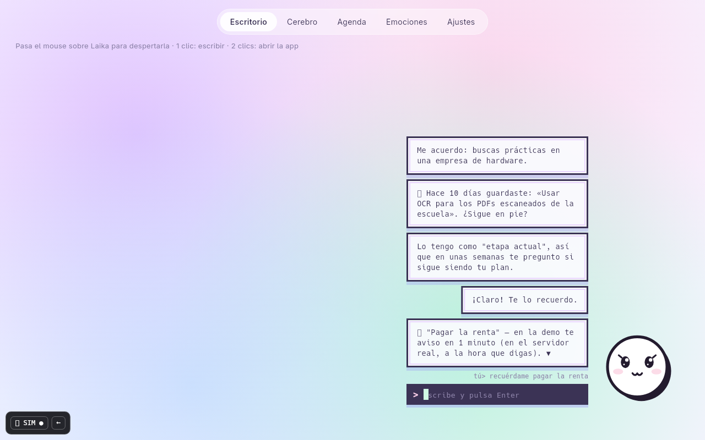 | 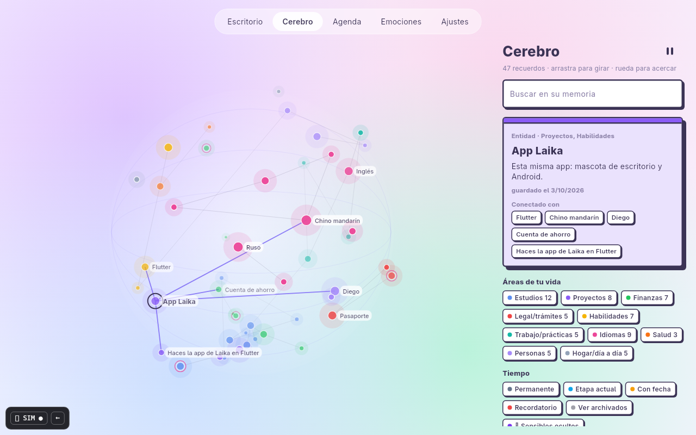 | 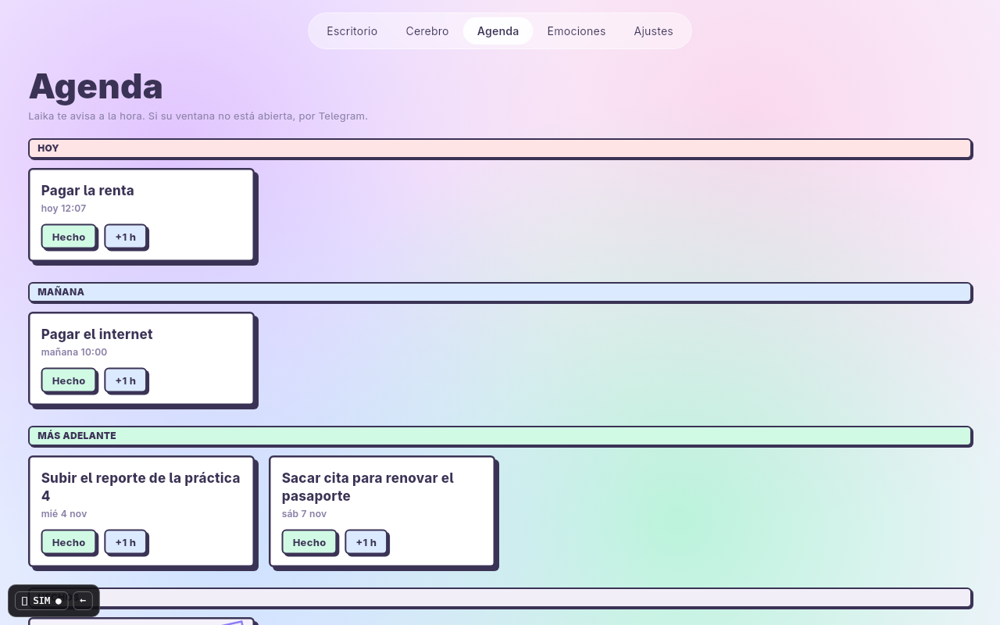 |

**Laika tiene 16 caras** y las cambia según lo que pasa y lo que dice (se ríe
con "jaja", se sorprende cuando suena un recordatorio, trama algo cuando lo
anota, se apena si algo falla, come cuando le mandas un PDF o un link…).
Sus mensajes se quedan el tiempo que toma leerlos (3 s por palabra; en chino
2 s por carácter + 3 s por palabra en pinyin o inglés) y luego se desvanecen. Por defecto es un círculo blanco estilo
Brutal; puedes darle **tu propia skin** con imágenes (ver
[`docs/SKINS.md`](docs/SKINS.md)) y elegirla en **Ajustes**, junto con su
tamaño y el servidor.

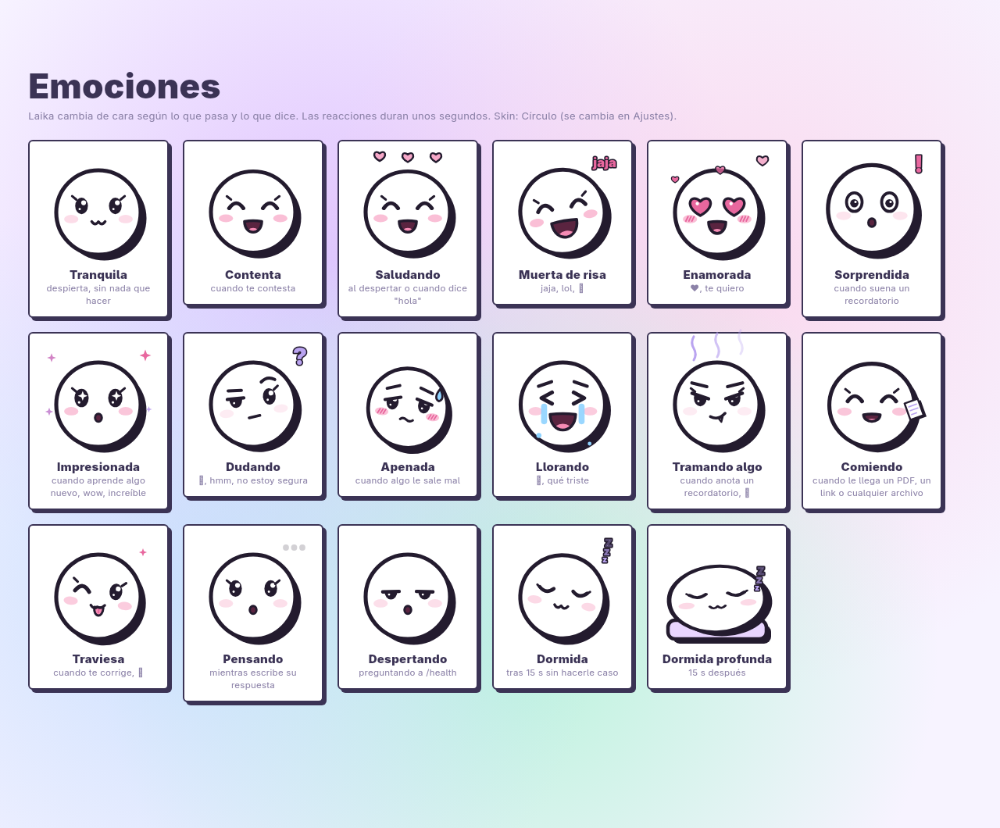

Los 5 prototipos con los que se eligió el estilo siguen en la galería:

| Cosmos | Papel | Pixel | Brutal | Cristal |
|---|---|---|---|---|
| 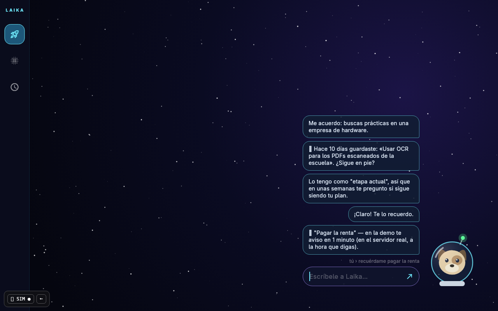 | 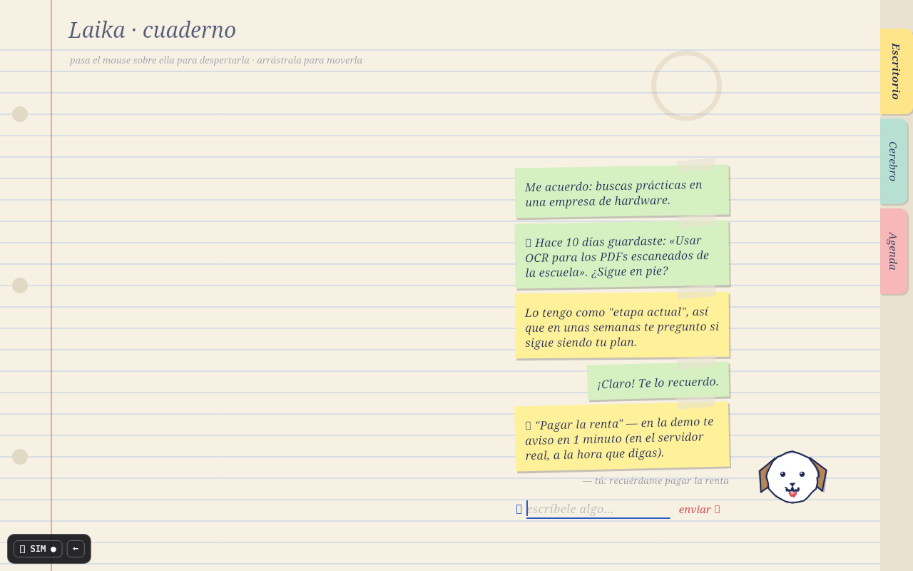 | 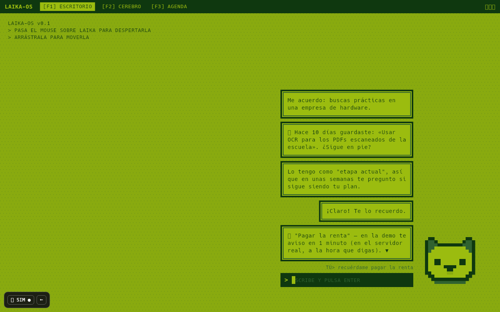 | 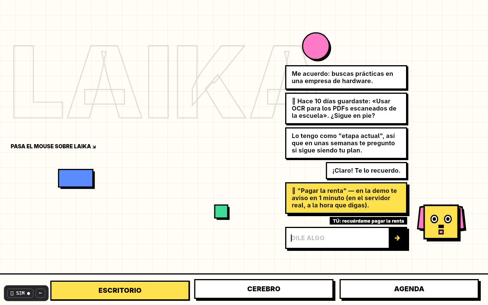 | 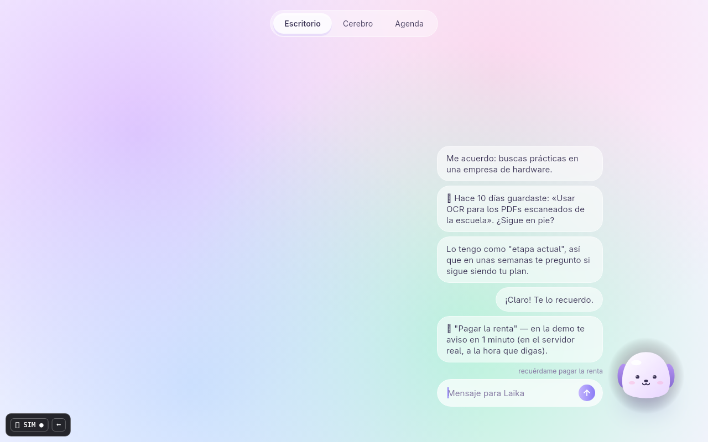 |
| 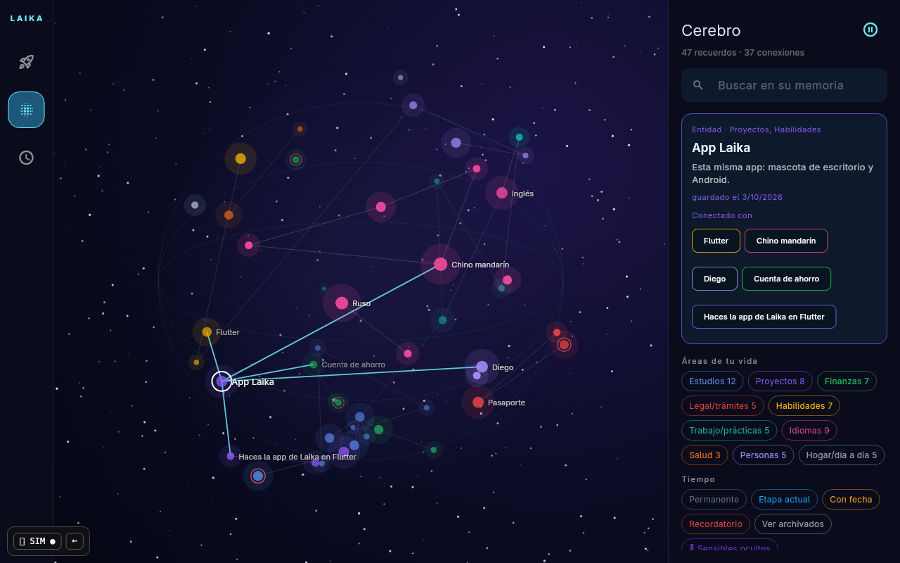 | 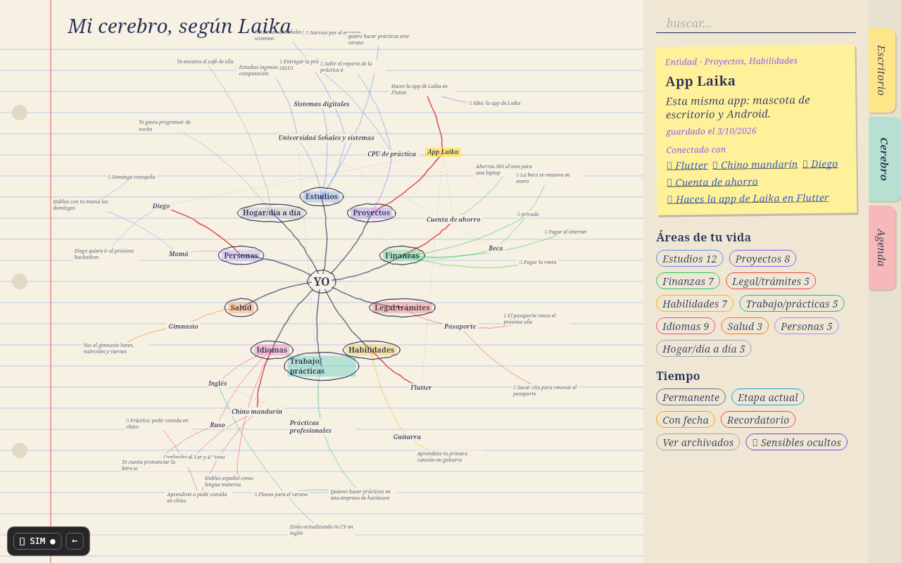 | 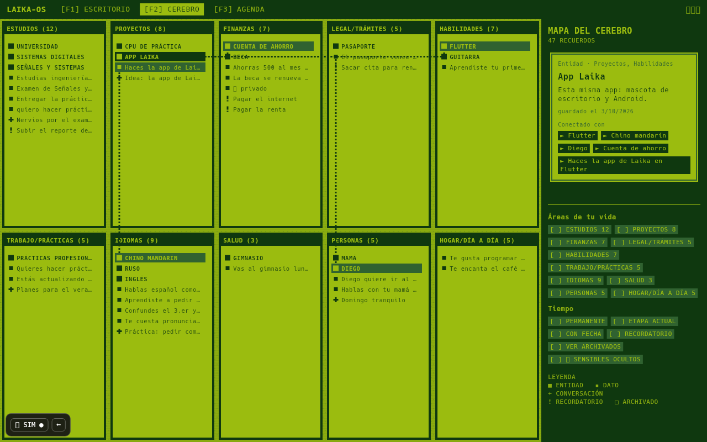 | 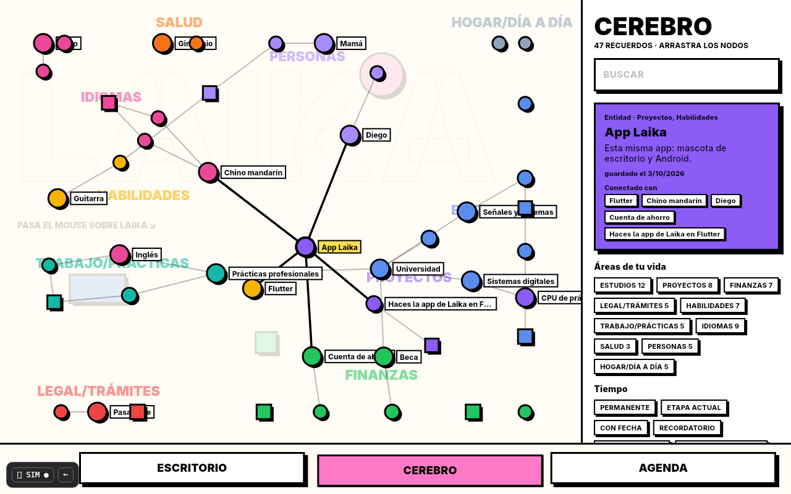 | 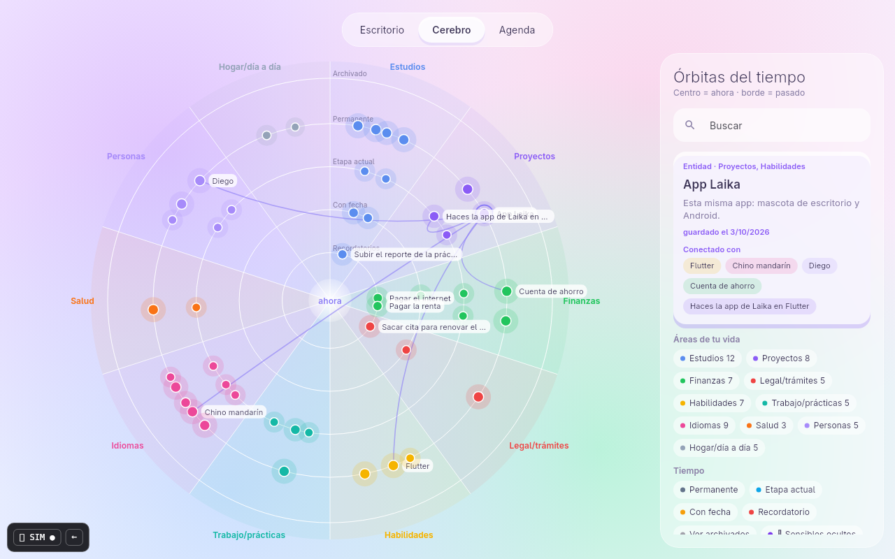 |

Más capturas y la descripción de cada diseño: [`docs/VARIANTES.md`](docs/VARIANTES.md).

## Contenido

1. [Cómo se comporta Laika](#1-cómo-se-comporta-laika)
2. [Requisitos](#2-requisitos)
3. [Instalar y ejecutar, paso a paso](#3-instalar-y-ejecutar-paso-a-paso)
4. [Probar los prototipos](#4-probar-los-prototipos)
5. [El cerebro: áreas y tiempo](#5-el-cerebro-áreas-y-tiempo)
6. [Pruebas y capturas](#6-pruebas-y-capturas)
7. [Cómo está organizado el código](#7-cómo-está-organizado-el-código)
8. [Siguientes pasos](#8-siguientes-pasos)
9. [Problemas comunes](#9-problemas-comunes)
10. [Licencia](#10-licencia)
11. [Autoría](#11-autoría)

## 1. Cómo se comporta Laika

Las reglas son iguales en los 5 diseños:

- **Se duerme sola** después de **15 segundos** sin que interactúes con ella.
- **Para despertarla**, pasa el mouse sobre ella (en Android: tócala). En ese
  momento la app hace **una sola** petición `GET /health` al servidor:
  - si el servidor responde y el modelo está cargado → **despierta**;
  - si no responde → **sigue dormida** y muestra "el servidor no responde".
  - No hay consultas en segundo plano: solo pregunta cuando tú la buscas.
- **El chat es solo una caja de texto.** Los mensajes de Laika salen **a su lado**:
  - si Laika está en la **mitad derecha** de la pantalla, sus mensajes salen a su **izquierda**;
  - si está en la **mitad izquierda**, salen a su **derecha**.
  - Puedes arrastrarla a donde quieras.
- **Recordatorios:** si uno suena mientras duerme, aparece una campanita; al
  despertarla, te lo dice. (En el servidor real también llega por Telegram.)
- **Datos sensibles** (los que el servidor marca como `sensitive`) se muestran
  como "🔒 privado" hasta que los desbloqueas en el cerebro.

## 2. Requisitos

| Qué | Versión probada | Para qué |
|---|---|---|
| Flutter | 3.47.5 (Dart 3.13) | todo |
| Linux: `clang`, `cmake`, `ninja`, `gtk3`, `pkg-config`, `gtk-layer-shell` | Arch Linux, KDE Plasma 6.8 (Wayland) | compilar para escritorio; `gtk-layer-shell` pone a Laika sobre tu escritorio |
| Android SDK | 36 | compilar para Android |

En Arch Linux:

```bash
sudo pacman -S clang cmake ninja gtk3 pkgconf gtk-layer-shell
```

Instala Flutter siguiendo <https://docs.flutter.dev/get-started/install/linux> y
comprueba con:

```bash
flutter doctor
```

Para Android además acepta las licencias una vez:

```bash
flutter doctor --android-licenses
```

## 3. Instalar y ejecutar, paso a paso

```bash
# 1. Descargar el código
git clone https://github.com/EstebanSantiag0/laika-app.git
cd laika-app

# 2. Descargar dependencias
flutter pub get

# 3. Abrir la galería de diseños (Linux)
flutter run -d linux
```

Para abrir directo un diseño:

```bash
flutter run -d linux --dart-define=VARIANT=cosmos    # cosmos | papel | pixel | brutal | cristal
```

En Android (con el teléfono conectado por USB y la depuración activada):

```bash
flutter devices                 # busca el id de tu teléfono
flutter run -d <id-del-teléfono>
```

Para generar un ejecutable de Linux:

```bash
flutter build linux --release
./build/linux/x64/release/bundle/laika_app          # galería de diseños
./build/linux/x64/release/bundle/laika_app --pet    # Laika sobre tu escritorio
./build/linux/x64/release/bundle/laika_app --app    # la app: cerebro, agenda y emociones
```

### Laika sobre tu escritorio (Linux, Wayland)

Con `--pet` la ventana es una capa transparente que cubre la pantalla, pero
**solo Laika y su chat reciben clics**: todo lo demás sigue funcionando debajo.

- Pasa el mouse sobre ella: hace **una** petición a `/health` y despierta solo si el servidor responde.
- **1 clic:** abre la caja para escribirle. **2 clics:** abre la app completa en una ventana normal.
- Arrástrala a donde quieras; sus mensajes salen del lado con más espacio.
- Si algo sale mal: `pkill laika_app`.

En X11 o sin `gtk-layer-shell`, `--pet` abre una ventana normal con el escritorio simulado.

### Conectar con el servidor real

Sin configuración la app usa un **servidor simulado**. Para el real, ponlo en
**Ajustes → Servidor**, o crea `~/.config/laika/config.json` (no va en el repositorio):

```json
{"server": "https://tu-servidor.tu-tailnet.ts.net"}
```

También sirve `LAIKA_SERVER=https://… laika_app --pet` o
`flutter run --dart-define=LAIKA_SERVER=https://…`. La conexión pasa por
Tailscale (`tailscale serve` pone la identidad), así que no hay contraseñas en la app.

### Instalarla para tu usuario

```bash
flutter build linux --release
tool/install_linux.sh                 # programa en ~/.local/share/laika-app + lanzadores en el menú
tool/install_linux.sh --autostart     # además, la mascota arranca al iniciar sesión
tool/install_linux.sh --uninstall     # quitar todo
```

## 4. Probar los prototipos

1. En la galería, elige un diseño.
2. **Pasa el mouse sobre Laika**: verás "preguntando al servidor…" y luego despierta.
3. Escríbele. Prueba:
   - `hola`
   - `quiero aprender a soldar` → lo guarda en su memoria como *etapa actual*
   - `recuérdame pagar la renta` → crea un recordatorio que, en la demo, suena en 1 minuto
4. No toques nada 15 s → se duerme.
5. Abre **⚙ SIM** (abajo a la izquierda):
   - apaga **Servidor en línea** y pasa el mouse sobre ella → **no despierta**;
   - sube la **latencia** para ver qué pasa con un servidor lento;
   - **Sonar recordatorio** dispara uno ya (con Laika dormida aparece la campanita).
6. Revisa las pestañas **Cerebro** y **Agenda**.
7. `←` regresa a la galería.

Cuando tengas un favorito, o quieras mezclar partes (por ejemplo, "la mascota
de Pixel con el cerebro de Cosmos"), anótalo; ver [`docs/VARIANTES.md`](docs/VARIANTES.md).

## 5. El cerebro: áreas y tiempo

Todo lo que Laika recuerda es un **nodo**:

| Tipo | Ejemplo |
|---|---|
| Entidad | "Universidad", "Flutter", "Mamá" |
| Dato | "Quieres hacer prácticas en una empresa de hardware" |
| Conversación | "Planes para el verano" |
| Recordatorio | "Pagar el internet — mañana 10:00" |

Cada nodo pertenece a una o más **áreas de tu vida** (Estudios, Proyectos,
Finanzas, Legal/trámites, Habilidades, Trabajo/prácticas, Idiomas, Salud,
Personas, Hogar/día a día) y tiene un **tiempo**:

| Tiempo | Significado | Qué pasa después |
|---|---|---|
| Permanente | siempre cierto | nada |
| Etapa actual | cierto *por ahora* | Laika te pregunta en unas semanas si sigue igual |
| Con fecha | evento o fecha límite | al pasar la fecha se archiva |
| Recordatorio | algo que te debe avisar | te avisa a la hora y se marca hecho |
| Archivado | ya no es actual | se conserva como historia, no se borra |

Cada diseño dibuja el cerebro distinto: esfera 3D (Cosmos), mapa mental
(Papel), cuartos de videojuego (Pixel), grafo de fuerzas (Brutal) y órbitas del
tiempo (Cristal).

## 6. Pruebas y capturas

```bash
flutter analyze        # revisa el código
flutter test           # 15 pruebas: despertar, burbujas a su lado, dormirse, servidor caído...
```

Las capturas de `docs/screenshots/` se generan con las fuentes de tu sistema:

```bash
flutter test tool/screenshots_test.dart --update-goldens
```

## 7. Cómo está organizado el código

```
lib/
├── main.dart              --pet / --app / galería de diseños
├── core/                  lógica compartida (igual en todos los diseños)
│   ├── models.dart        datos: nodos, áreas, recordatorios (contrato de la API)
│   ├── api.dart           interfaz con el servidor
│   ├── http_laika.dart    cliente real (HTTPS + WebSocket)
│   ├── config.dart        ajustes en ~/.config/laika/config.json
│   ├── mock_backend.dart  servidor simulado
│   ├── sample_data.dart   recuerdos de ejemplo (ficticios)
│   ├── pet.dart           reglas de la mascota (dormir, despertar, burbujas)
│   ├── stage.dart         el escritorio y la regla de "mensajes a su lado"
│   ├── brain.dart         filtros del cerebro y agenda
│   ├── layouts.dart       cómo se acomodan los nodos (esfera, radial, fuerzas…)
│   ├── session.dart       une todo + panel de simulación
│   ├── sphere_view.dart   cerebro en esfera 3D
│   └── widgets.dart       piezas reutilizables
├── desktop/               Laika sobre el escritorio real (Linux)
│   ├── pet_overlay.dart   la capa transparente
│   └── window_bridge.dart qué zonas reciben clics (canal con linux/runner)
├── pets/
│   ├── circle_face.dart   la cara-círculo por defecto: 16 emociones y 2 formas de dormir
│   └── skins.dart         skins de imágenes (~/.config/laika/skins, ./skins)
└── variants/              diseños: laika.dart (el elegido) + los 5 prototipos
    ├── laika.dart  cosmos.dart  papel.dart  pixel.dart  brutal.dart  cristal.dart
    └── variants.dart      lista de diseños
linux/runner/my_application.cc   ventana nativa; modo --pet con gtk-layer-shell
tool/install_linux.sh            instalar para tu usuario
tool/make_skin.py                armar una skin con tus imágenes
```

Explicación completa: [`docs/architecture.md`](docs/architecture.md).
Contrato con el servidor: [`docs/API.md`](docs/API.md).

## 8. Siguientes pasos

1. ✅ Elegir diseño (mezcla final en `lib/variants/laika.dart`).
2. ✅ `HttpLaika`: cliente real (HTTPS + WebSocket por Tailscale).
3. ✅ Linux: Laika sobre tu escritorio real (`--pet`, `gtk-layer-shell`).
4. Recordar dónde dejaste a Laika en la pantalla.
5. Android: burbuja flotante sobre otras apps y notificaciones de recordatorios.
6. Animaciones finales y alimentar a Laika arrastrándole PDFs o enlaces.

El avance día a día está en [`docs/PROGRESS.md`](docs/PROGRESS.md).

## 9. Problemas comunes

| Problema | Solución |
|---|---|
| `flutter run -d linux` dice que falta CMake/GTK | instala los paquetes de la sección 2 |
| Los emojis salen como cuadritos | instala una fuente de emojis (`noto-fonts-emoji` en Arch) |
| Android: "licenses not accepted" | `flutter doctor --android-licenses` |
| Las capturas salen distintas en otra computadora | es normal: dependen de las fuentes instaladas |
| Falla el build: `gtk-layer-shell-0 not found` | `sudo pacman -S gtk-layer-shell` |
| `--pet` abre una ventana normal | estás en X11 o el compositor no soporta *layer-shell*; usa Wayland |
| Una capa invisible no deja hacer clic | `pkill laika_app` y avísame (abre un *issue*) |
| Laika nunca despierta con el servidor real | revisa `~/.config/laika/config.json` y que Tailscale esté conectado |

## 10. Licencia

[MIT](LICENSE).

## 11. Autoría

- **Idea, diseño del producto, reglas de comportamiento y dirección del proyecto:**
  Esteban Santiago ([@EstebanSantiag0](https://github.com/EstebanSantiag0)).
- **Código (prototipos, mascotas, cliente y modo escritorio) y documentación:** escritos con ayuda de Claude
  (IA de Anthropic), siguiendo las decisiones y revisiones de Esteban.
