# Los 5 diseños

Todos tienen **el mismo comportamiento** (ver README §1). Solo cambia cómo se ven.
Para elegir: ábrelos con `flutter run -d linux`, juega con cada uno y anota
qué te gusta. Se pueden mezclar piezas: mascota, burbujas, caja de texto,
cerebro y agenda son independientes.

## 1 · Cosmos — `--dart-define=VARIANT=cosmos`

Perrita espacial con casco de vidrio. La **antena** indica el estado: roja
(dormida), ámbar parpadeando (preguntando al servidor), verde (despierta).
Burbujas oscuras con borde de neón. **Cerebro:** esfera 3D de estrellas; cada
área ocupa una zona; se gira arrastrando y se acerca con la rueda.

| Escritorio | Cerebro | Agenda |
|---|---|---|
| 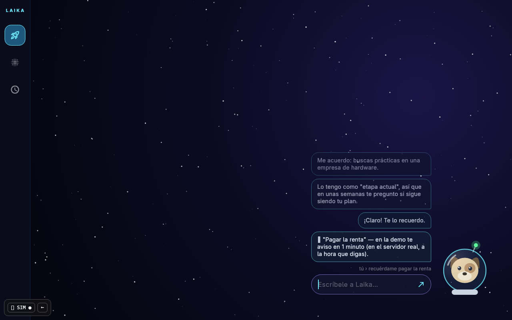 | 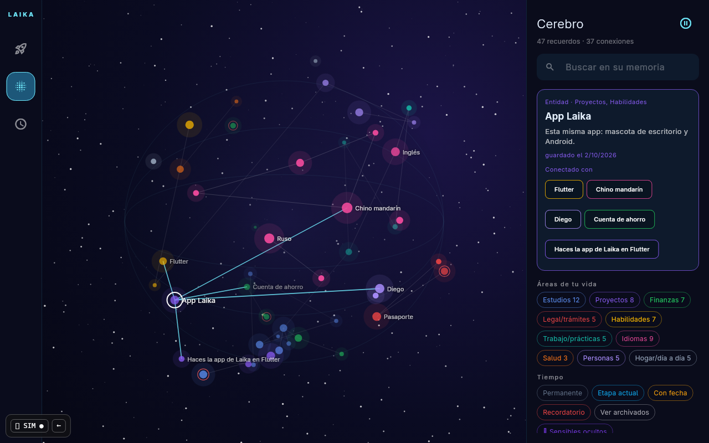 | 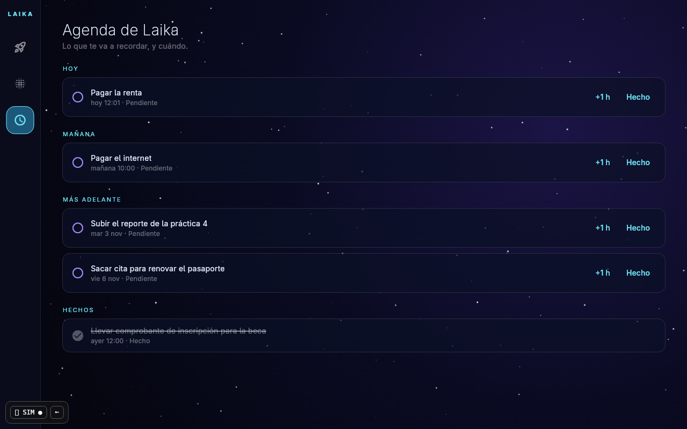 |

## 2 · Papel — `--dart-define=VARIANT=papel`

Cuaderno rayado. Laika está dibujada a mano y sus líneas "tiemblan". Sus
mensajes son **notas adhesivas**; tú escribes sobre un renglón. Pestañas de
cuaderno a la derecha. **Cerebro:** mapa mental en tinta: YO → áreas →
entidades → datos; se mueve y se acerca como un mapa.

| Escritorio | Cerebro | Agenda |
|---|---|---|
| 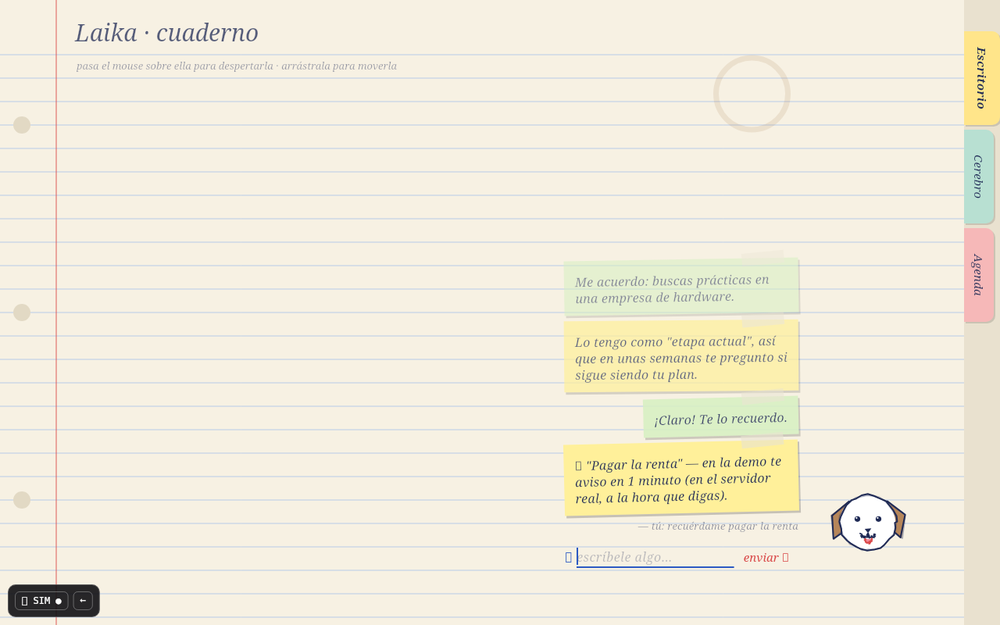 | 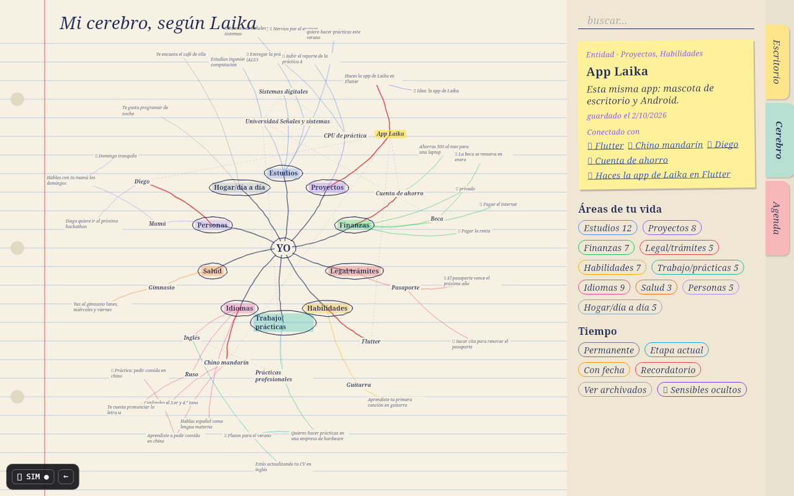 | 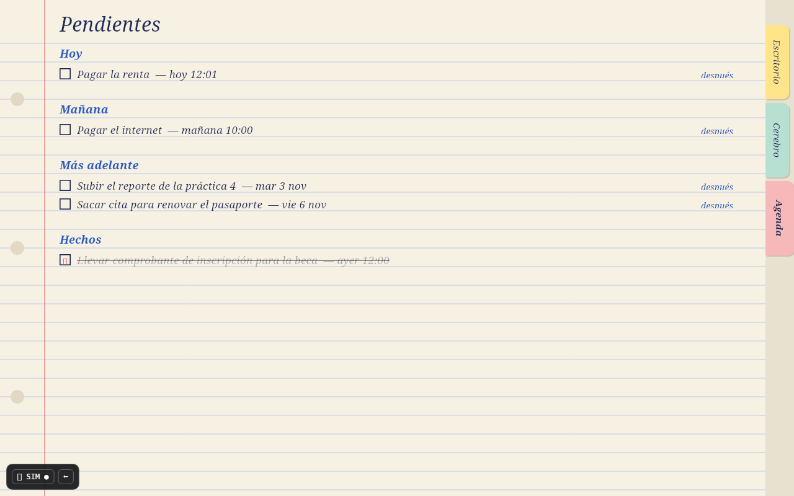 |

## 3 · Pixel — `--dart-define=VARIANT=pixel`

Consola retro de 4 verdes. Laika es un sprite de 16×16; sus mensajes son
**cuadros de diálogo** que se escriben letra por letra. Atajos F1/F2/F3.
**Cerebro:** un "cuarto" por área con la lista de lo que hay dentro; al elegir
un recuerdo, sus conexiones se marcan como pasillos.

| Escritorio | Cerebro | Agenda |
|---|---|---|
| 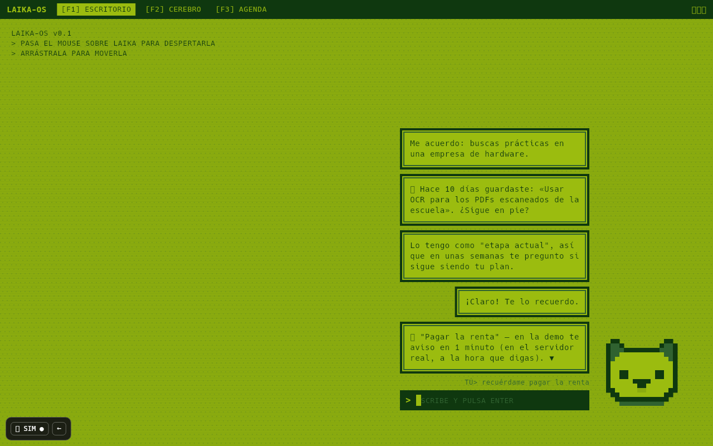 | 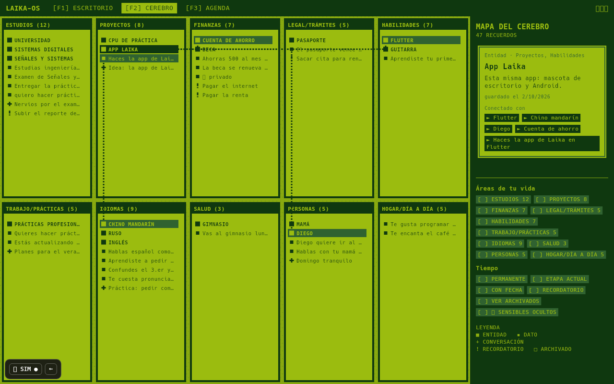 | 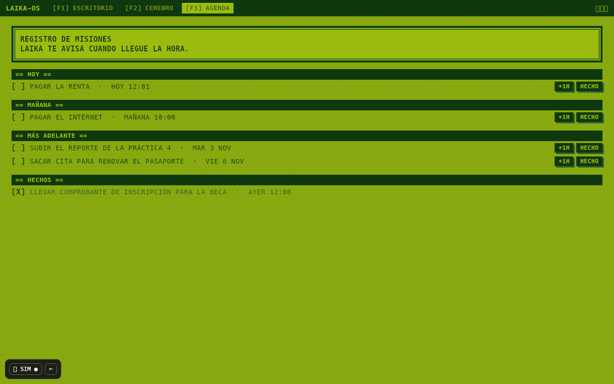 |

## 4 · Brutal — `--dart-define=VARIANT=brutal`

Neobrutalismo: bordes negros gruesos, sombras duras, colores planos, letras
enormes. Laika es un bloque amarillo que rebota. **Cerebro:** grafo de fuerzas;
**cada nodo se puede arrastrar**, el fondo se mueve y la rueda acerca.

| Escritorio | Cerebro | Agenda |
|---|---|---|
| 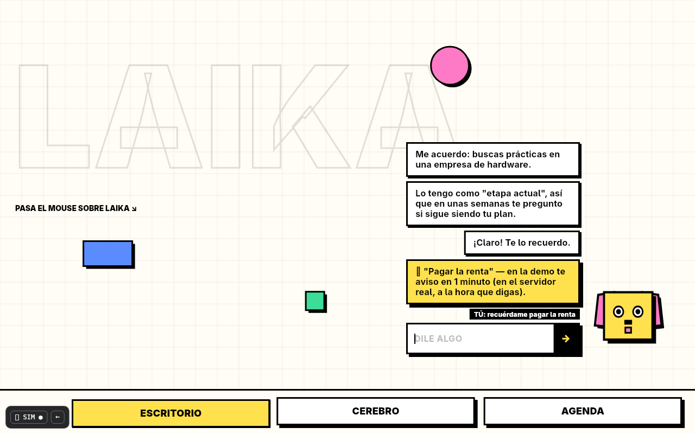 | 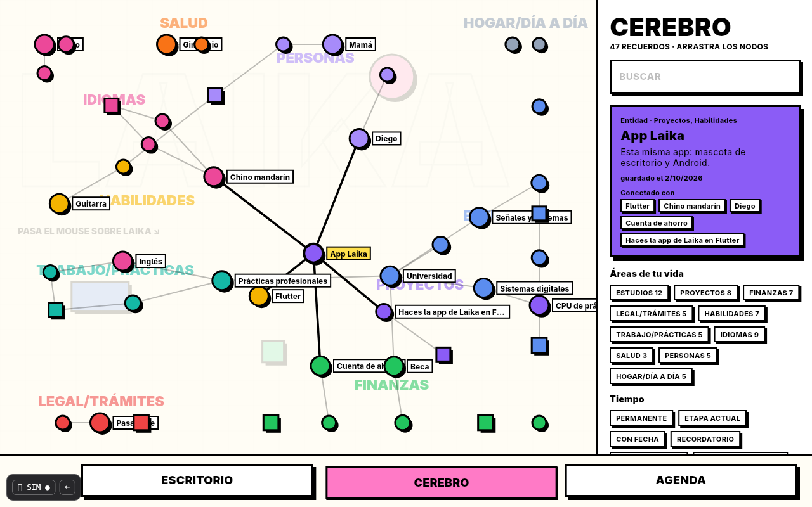 | 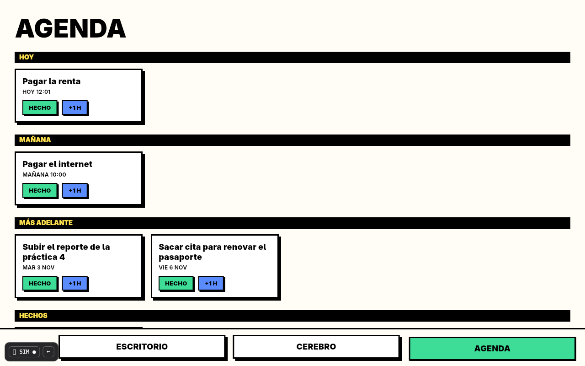 |

## 5 · Cristal — `--dart-define=VARIANT=cristal`

Pastel y vidrio esmerilado; manchas de luz que se mueven despacio. Laika es una
gotita suave con orejas caídas y una lunita cuando duerme. **Cerebro:**
"órbitas del tiempo": el centro es *ahora* (recordatorios), luego lo que tiene
fecha, la etapa actual, lo permanente y en el borde lo archivado; cada área es
una rebanada.

| Escritorio | Cerebro | Agenda |
|---|---|---|
| 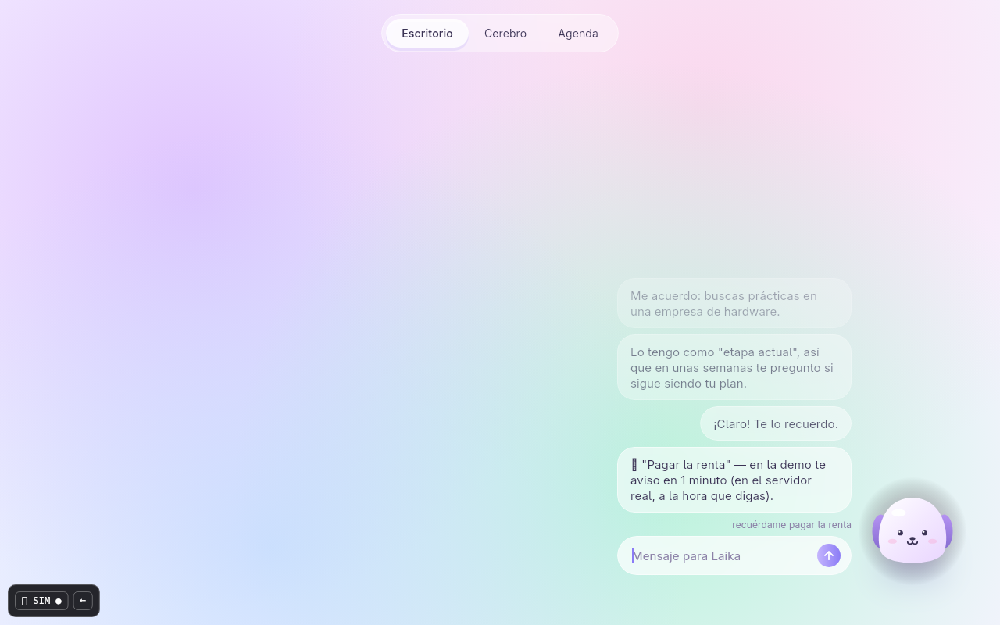 | 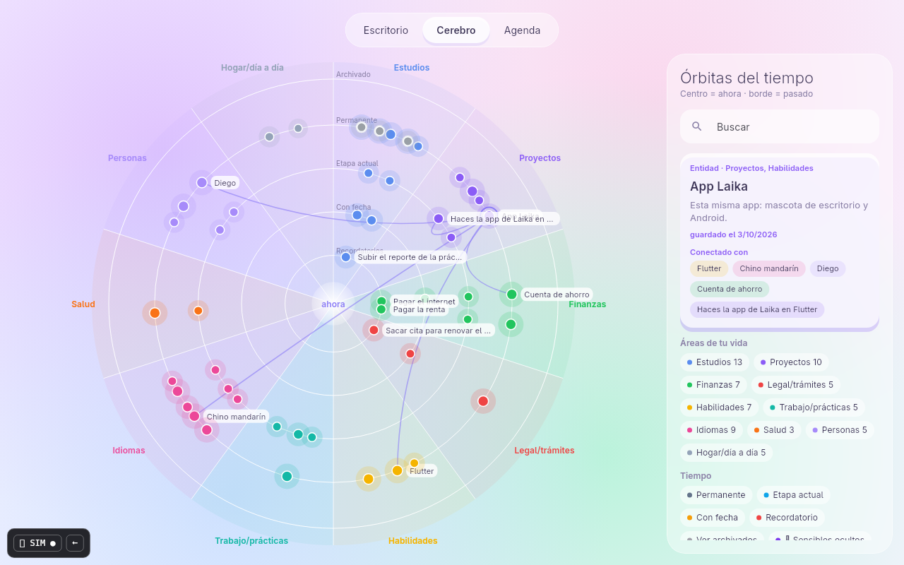 | 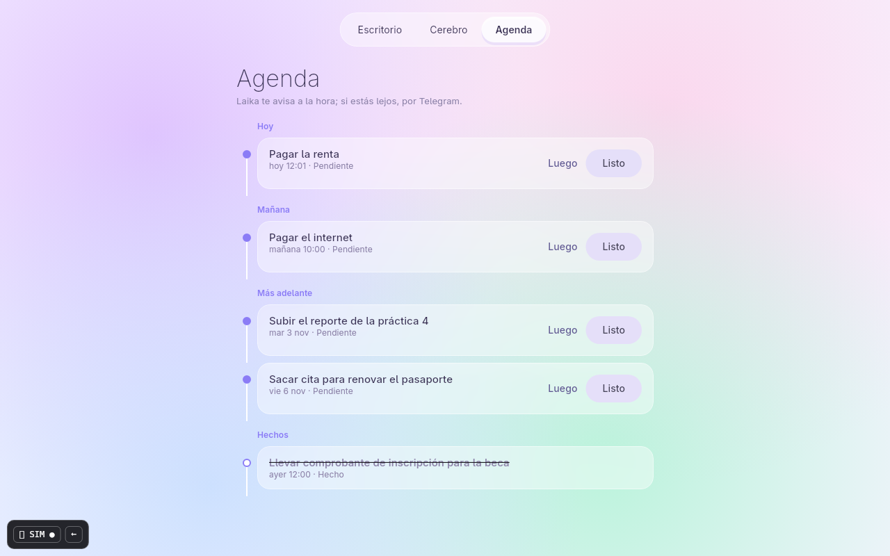 |

## Plantilla para tu decisión

```
Diseño base: ____________
Mascota de: ____________   Burbujas de: ____________
Cerebro de: ____________   Agenda de: ____________
Cambios: ____________________________________________
```
